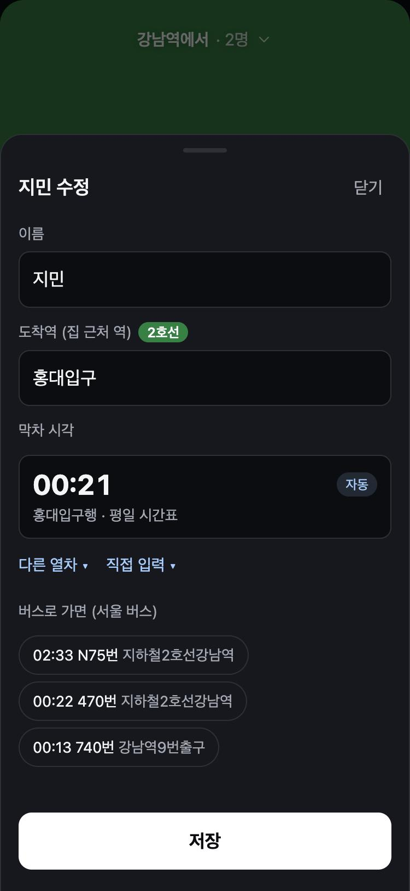
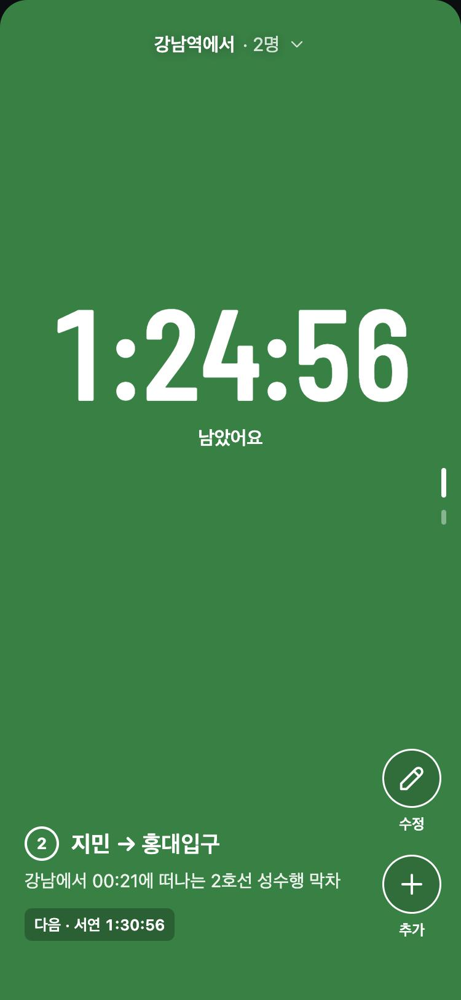
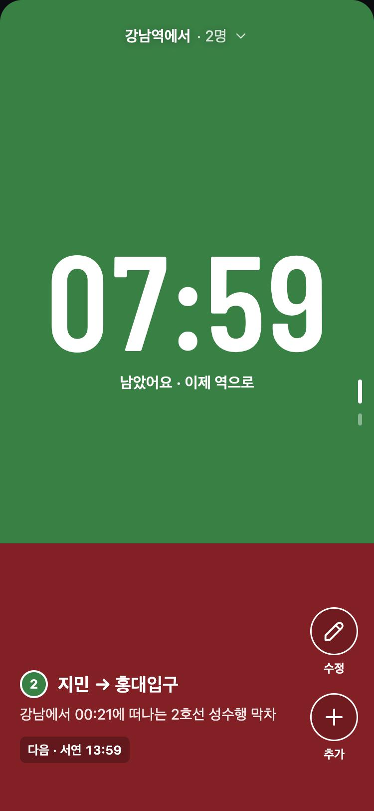

# 막차 카운트다운

같은 역에서 헤어지는 사람들이 각자의 막차까지 **얼마나 남았는지** 한 화면에서 보는 모바일 웹앱.

함께 출발하는 역 하나와 사람마다 집 근처 역을 넣으면, 각자의 막차가 출발역을 떠나는 시각까지 카운트다운한다. 가장 급한 사람이 먼저 보이고, 위로 넘기면 다음 사람이다.

**서비스:** https://lastrain-ukck.vercel.app

<p>
  
  
  
</p>

## 왜 만들었나

지도 앱의 막차 검색은 경로를 보여준다. 밤늦게 같이 있다가 헤어질 때 궁금한 건 "언제까지 같이 있어도 되나"라서, 이 앱은 **남은 시간**을 주인공으로 두고 그 숫자를 믿을 수 있게 **막차를 정확히 판정**하는 데 집중했다.

## 주요 기능

- **열차 번호로 막차 판정** (1~9호선): 출발역 막차가 정말 도착역까지 가는지 서울 시간표의 열차 번호로 확인한다. 중간에서 끝나는 열차는 막차로 치지 않는다.
- **토요일·휴일·공휴일 시간표 구분**: 서울 주말 막차는 평일보다 크게 이르다(강남→홍대입구 평일 00:21, 토·휴일 23:24).
- **환승 막차 역산**: 마지막 구간 막차부터 거꾸로 계산한다. 지하철과 서울 버스가 섞인 경로도 계산한다.
- **실시간 보정**: 막차 60분 전부터 실시간 도착을 붙여, 막차가 일찍 오면 카운트다운을 앞당긴다(늦으면 안내만).
- **1~6명**, 현재 위치로 출발역 찾기, 홈 화면 추가(PWA)·오프라인 열기.
- 판정할 수 없으면 "안 간다"로 본다. 틀리더라도 더 이른 막차를 알려주는 쪽이 안전하다. 추정한 값은 화면에 "(추정)"으로 표시한다.

## 기술

- Next.js (App Router) + TypeScript, Tailwind CSS, Vercel(서울 리전)
- 로그인·DB 없음. 사람 목록은 각자 브라우저(localStorage)에만 저장한다.
- 외부 API 키는 서버 라우트(`app/api/*`) 안에서만 쓰고, 모든 라우트에서 zod 입력 검증과 IP별 호출 제한을 건다.
- 시간 계산·막차 판정·환승 역산은 순수 함수(`lib/time.ts`, `lib/transfer.ts`, `lib/seoulReach.ts` 등)로 분리해 vitest로 테스트한다.

## 데이터 출처

- 서울특별시 공공데이터 (서울 열린데이터광장): 1~9호선 시간표, 실시간 지하철 도착
- 국토교통부 TAGO (공공데이터포털): 역 검색, 1~9호선 밖 지하철 시간표
- 서울특별시 버스 (공공데이터포털): 노선별 정류장 막차, 실시간 버스 도착
- 카카오: 역 좌표, 근처 역, 대중교통 경로

## 직접 실행하기

Node 20 이상, pnpm이 필요하다.

```bash
pnpm install
cp .env.example .env.local   # 아래 키를 채운다
pnpm dev                     # http://localhost:3000
```

| 키 | 발급처 |
|---|---|
| `TAGO_SERVICE_KEY` | 공공데이터포털 (TAGO 지하철, 서울 버스 활용 신청) |
| `SEOUL_OPENAPI_KEY` | 서울 열린데이터광장 일반 인증키 |
| `SEOUL_SUBWAY_REALTIME_KEY` | 서울 열린데이터광장 실시간 지하철 인증키 |
| `KAKAO_REST_API_KEY` | 카카오 디벨로퍼스 REST API 키 |

```bash
pnpm test        # vitest
pnpm typecheck   # tsc --noEmit
```

`?now=23:40`을 주소 뒤에 붙이면 그 시각부터 시계가 흐르는 것처럼 동작한다(낮에 막차 화면 확인용).

## 폴더

- `app/`: 화면과 API 라우트
- `components/`: 화면 부품
- `lib/`: 막차 계산과 외부 API 호출
- `tests/`: vitest
- `spike/`: 외부 API를 검증한 스크립트. 막차 판정 방식을 정하기까지의 실험이 남아 있다
- `docs/`: 진행 상황(`progress.md`)과 학습 노트
- `PRODUCT.md`, `DESIGN.md`: 제품 방향과 디자인 체계
